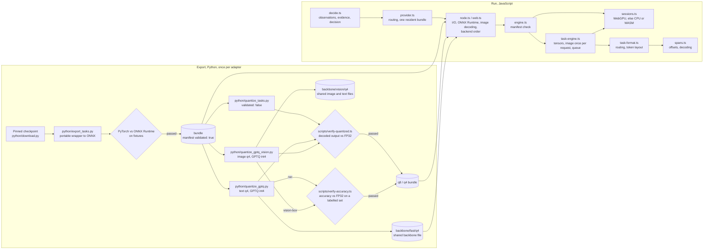

# Architecture

defuss-decide answers typed decisions (yes/no, or one of several options) over JSON, text and images with Vela3's trained decision heads, and runs the eight Vela3 task adapters it builds on. It has two halves that meet in one file format. Python (`python/`) turns a pinned upstream checkpoint into a bundle once; TypeScript (`src/`, compiled to JavaScript in `lib/`) loads bundles and answers questions in Node.js, Bun and browsers. The bundle's `manifest.json` is the contract between them.

## Why this design

**Export once, verify, then never touch Python again.** The alternative, running the upstream Python behind a server, needs a GPU or CPU service, a network hop and a deployment per app. Exporting needs neither at runtime, but a wrong export would silently return confident wrong spans. So the exporter compares PyTorch and ONNX Runtime on recorded cases and writes `validated: true` only after that; `VelaDecision.load` refuses everything else on every runtime. Quantized variants start unvalidated and are unlocked by a JavaScript gate that compares their decoded output with the FP32 fixtures, because decoded spans, not raw logits, are what callers consume.

**Port the input layout and the decoders line by line.** The adapters read fixed positions (label markers, first word tokens, image tokens), so "close" rendering produces plausible garbage. `format.ts`, `task-format.ts` and `spans.ts` reproduce the upstream Python, including its quirks: code-point offsets, Python's whitespace set, the U+8C48 start of the text decoder's CJK range, `True`/`False` in OCR fields. Where upstream is lossy (it truncates long vision answers at 768 tokens), the port refuses instead, because a silently unchecked tail reads as a clean result.

**One runtime-independent engine, thin runtime adapters.** `engine.ts`, `task-engine.ts`, `task-format.ts`, `spans.ts`, `format.ts` and `image.ts` contain no I/O. `node.ts` (Node.js and Bun: `onnxruntime-node`, sharp, the file system) and `web.ts` (browsers: `onnxruntime-web`, `createImageBitmap`, fetch) only inject reading, session creation and image decoding. The same tests therefore cover every runtime, and a decoder fix cannot reach one runtime but not another.

**TypeScript, compiled per module.** The sources use only syntax that type stripping can erase (`erasableSyntaxOnly`) and import each other by their `.ts` names. Node.js and Bun run the scripts on the sources directly, Vitest and Bun run the tests on them, and `tsc` rewrites the imports to `.js` when it compiles `lib/`, one JavaScript file and one declaration file per source. The package cannot ship the `.ts` sources instead: VERIFIED: Node.js 26.11.1 refuses to strip types under `node_modules` (`ERR_UNSUPPORTED_NODE_MODULES_TYPE_STRIPPING`). One file per source also lets the website load the same modules the package ships. VERIFIED: the website's compiled modules equal the `lib/` build byte for byte apart from their first comment line.

**GPU first, with a visible fallback.** The loaders try ONNX Runtime's WebGPU provider and fall back to the CPU (Node.js, Bun) or WASM (browsers) when the bundle does not load there. VERIFIED: on an Apple M-series Mac all 22 real bundles passed parity on WebGPU in Node.js, Chromium 156 and WebKit 27.2, and WebGPU answered an image question in 0.29 s in Node.js against 1.33 to 1.37 s on 4 CPU threads (`make bench`), and in 0.35 to 0.62 s in the browsers against 21 to 26 s on single-threaded WASM. WASM only, the previous design, leaves that speed unused. A silent fallback would make results depend on the visitor's hardware unnoticed, since the backends differ within the parity tolerance; so every response names its `backend`, a `fallback` progress event reports the switch, and `backend` can be pinned. A whole bundle runs on one backend, because the image features feed the task graph and splitting the graphs would copy them between devices. CoreML, the other GPU path this ONNX Runtime build has on macOS, is excluded. VERIFIED: it took 127 s for 1,800 text tokens and missed the vision tolerance (0.020 > 0.015). ONNX Runtime has no MPS provider. Short text is the exception: about 25 ms on the CPU against 50 ms on WebGPU for inputs of a few dozen tokens, so servers answering many short texts may pin `backend: "cpu"` ([performance](documentation/performance.md)).

**Decide with a trained head, explain with evidence.** A `decide` question runs the image tasks (with images), then the evidence adapter, then the `choice`/`noul` decision head ([documentation/decide.md](documentation/decide.md)). The plausible alternative, deciding from evidence spans alone, fails. VERIFIED: scoring "Yes" against "No" by evidence spans picked right in 3 of 7 JSON cases, chance level, while the text decision head answered 18 of 20 (probes, 2026-11-08). So evidence only marks the fields an answer rests on. The image tasks' findings enter the state as text lines, worded by confidence ("the image does not show X"), because a plain box line made the vision head answer yes for absent objects (VERIFIED: 2 of 4 image cases wrong; 4 of 4 right with the wording). VERIFIED: the pipeline answered 24 of 26 hand-written cases (`reports/decide/node-auto.json`), a smoke test, not a benchmark.

**One resident bundle.** Every adapter carries its own backbone (0.5 to 1.8 GB in FP32), and the vision adapters use different backbone weights, so sharing is wrong and holding all eight exceeds a browser tab's 32-bit WASM address space. `VelaProvider` serializes requests and releases the old bundle before loading the next. Within a request it routes every question first and then runs the questions of each adapter together, the resident one first, so a request loads each bundle at most once. Across requests, switching still costs a reload.

**The browser reads the bundle files itself.** `web.ts` fetches every file of a bundle and hands ONNX Runtime Web bytes, not URLs. The alternative, passing URLs as before, leaves the fetch to ONNX Runtime, which reports no progress and cannot decode Brotli. With one reader, `onProgress` gets `download` events per file, `brotli: true` fetches `<file>.br` and decodes it with defuss-brotli (imported on the first `.br` file, so other loads never fetch it), and fetches the file itself when the copy is missing (404, or an HTML page from a dev server), and `cache` keeps each decoded file in the Cache API under its own URL. Why Brotli copies: Hugging Face sends large files without transport compression. VERIFIED: the copies are 8 % smaller for the q4 text backbone and 63 % for the FP32 image decision graph (file sizes in `models/`, 2026-11-09). Why the decoded bytes are cached: a cached load needs no decoder. Why the cache is opt-in: entries are never revalidated, so it fits only URLs whose content never changes, such as a pinned Hugging Face revision. The website enables it for exactly that case. A failed backend re-reads the bundle's files for the next one, from the cache when there is one, so a load never holds more than one graph's files.

**The smallest published bundle by default.** Every published task precision passed a check against FP32. For all but two bundles it is the task gate: the largest change of a decoded score at most 0.02 and no changed answer on the reference inputs (`reports/quantization-tasks.json`). The q4 bundles of `ner` and `vision-box` change an answer there, because an answer next to a threshold moves under any 4-bit weights, and passed an accuracy gate on public labelled sets instead (`scripts/verify-accuracy.ts`): the entity F1 at most 1 point below FP32, and the point in the labelled region for at most 2 percentage points fewer expressions. VERIFIED: `ner` q4 has an F1 of 0.560 against 0.557 on 3,000 Few-NERD sentences and gives another entity set than FP32 in 24 % of them; `vision-box` q4 points into the labelled region for 1,054 of 1,500 RefCOCO expressions against 1,062 (`reports/quantization-accuracy.json`, 2026-11-12). Why accuracy and not the fixture rule for these two: the rule kept them at q8, 517 MB and 320 MB of download against 88 MB beside the shared backbone and 146 MB, for one borderline answer each. So `loadVelaProvider()` without bundles, and every run on the website, load each task in q4. The text decision bundle in q4 has a gate of its own (`python/verify_decision.py`), because a decision is one option out of few and a question on which FP32 is nearly undecided changes its option under any change of the weights: at most 3 % of the answers may differ from FP32 on each set, and at most 1 percentage point fewer may be correct. VERIFIED: it answers 1,103 of 1,300 BoolQ validation questions correctly, as FP32 does, and differs from FP32 on 26 of them (2.0 %), on 3 of 177 held-out decisions and on none of the 56 labelled cases; one of 5 recorded fixtures changes its answer (`reports/quantization-decision.json`, 2026-11-10). It adds 10.7 MB to the text backbone the q4 tasks share, against 1,329 MB in FP32. VERIFIED: a rank-16 repair, closed-form corrections and quantization-aware training did not bring the differing answers below 16 in 1,000 unseen questions, so the documentation states the share instead of hiding it behind a fixture rule. The alternative, q8 everywhere, downloads 1.7 to 2.2 times more for one q4 task and 4.6 times more for the five text tasks together, whose q4 bundles share one backbone (`.br` sizes, `reports/model-sizes.json`), without a measured gain. VERIFIED: the README's Node.js examples printed the same documented output with the smallest task bundles as with FP32 (real models, 2026-11-09). One module, `src/winzling.ts`, owns the release's layout and precisions; the website builds every bundle URL from it, and a unit test compares it with the size record, which lists the validated bundles.

**Deterministic preprocessing in JavaScript.** `image.ts` reimplements Pillow's Lanczos resampling with its fixed-point rounding instead of using canvas or sharp scaling, whose kernels differ and move the image features. Decoding stays in the runtime adapters with orientation, alpha and color conversion turned off, so both runtimes hand the same RGB bytes to the same resize.

## How it works

| Module | Responsibility |
| --- | --- |
| `src/winzling.ts` | The published release, kyr0/winzling-decide-1.0: repository, pinned commit, folder layout and the published precisions per task; the loaders' default, each task in its smallest published precision |
| `src/node.ts`, `src/web.ts` | Runtime entry points: `loadVela` and `loadVelaProvider` with file system or HTTP loading (in the browser with download progress, optional Brotli files and an optional Cache API cache), the ONNX Runtime package and image decoding |
| `src/node-session.ts` | One graph as an onnxruntime-node session; a graph with a weight file shared from another folder (the q4 backbone) is passed as bytes, because ONNX Runtime refuses data files outside the graph's folder |
| `src/engine.ts` | The single manifest gate for every bundle; the v0.1 `choice`/`noul` decision engine |
| `src/sessions.ts` | Session creation on the first backend that loads all graphs of a bundle, with `fallback` events |
| `src/task-engine.ts` | `VelaTask`: tokenizer and sessions of one task bundle, image encoding once per request, tensor feeding, the call queue, disposal |
| `src/task-format.ts` | Upstream span routing, label normalization, text and vision token layouts, OCR flattening, answer assembly |
| `src/spans.ts` | Code-point offsets from tokenizer bytes, word splitting, span decoding (voting, gap filling, trimming), region decoding |
| `src/format.ts`, `src/image.ts` | v0.1 decision layouts and softmax; Idefics3-style resize and tiling |
| `src/provider.ts` | `VelaProvider`: routes each question to its bundle, keeps one resident, runs `decide`, `relate` and line-by-line OCR questions step by step |
| `src/decide.ts` | The typed decision pipeline's pure steps: state as text lines, image observations, the decision question, the mean of two answers, the answer |
| `src/relate.ts` | Paragraph relations: the four-option question per paragraph, its scores and the ranking |
| `src/ocr-lines.ts` | The line-by-line OCR check's pure steps: lines with code-point offsets, the strip per line, merging the answers |
| `src/task-verify.ts` | The parity gates shared by the Node.js, Bun and Chromium checks |
| `src/types.ts` | The public and cross-module types: questions, requests, answers, manifests, the ONNX Runtime and loader contracts |
| `python/` | Download with pinned revisions and hashes, export with the parity gate, quantization |
| `scripts/` | Parity and quantization checks, the e2e suite, the website generator, the static server, repository rules (TypeScript, run directly by Node.js and Bun) |
| `docs/` | The website; `assets/page.js` runs theme, language (defuss-i18n), deep links (defuss-dom-router), install switch, copy toasts and charts, `assets/site.js` the playgrounds (bundles from a pinned revision of `kyr0/winzling-decide-1.0` on Hugging Face, one engine kept in memory between runs, a download progress bar), `assets/lib/` holds the browser modules compiled from `src/`, `assets/vendor/highlight.js` the Shiki bundle for its JSON, `assets/samples/synthetic/` the sample images, `llms.txt` the summary for coding agents |
| `tests/` | Unit suites (Node.js and Bun), browser suite (Chromium, WebKit), e2e specs, fixture bundles |

A request flows through `systemOne`: questions are validated, routed (`routeFastSpan` or `visionTask`), rendered to token ids with positions (`formatFastSpan`, `formatVisionTask`), turned into int64/float32 tensors, run, and decoded (`taskAnswer`). Every question is rendered before the first inference, so an invalid one fails before the slow steps. Images are decoded by the runtime, preprocessed into 512 px tiles plus a global view and encoded tile by tile, once per request; their features are inserted at the image-token positions through `image_indices`.

The fixture bundles in `tests/fixtures/bundles/` keep the real manifests, tokenizers and upstream fixtures with tiny synthetic graphs. They let CI check tokenization, routing and decoding parity with upstream Python and exercise the whole loading and inference path in four runtimes, without multi-GB downloads.

## Operations

- **Configuration:** none at runtime beyond the loader options. Development reads an optional `.env` (`.env.example`): `CHROMIUM_EXECUTABLE_PATH` for the parity scripts, `E2E_MODELS=real` for the real-model e2e, `PORT` for `make demo`.
- **Build and release:** `tsc -p tsconfig.build.json` compiles `src/*.ts` into `lib/` (JavaScript plus declarations, one file per module); `exports` point at `lib/`, and `bun pm pack` runs it as `prepack`, so the tarball the e2e installs is always freshly compiled. `make build` builds the library and the demo pages; the website in `docs/` is static and partly generated by `make docs`, which compiles the browser modules with the same compiler and options.
- **Compatibility:** the package (`lib/`, plain JavaScript) runs on Node.js 22 or newer, Bun 1.4, Chromium and WebKit with WebAssembly SIMD. WebGPU is used where ONNX Runtime and the machine offer it: `onnxruntime-node` lists it on macOS arm64 (VERIFIED), browsers when they grant an adapter. Playwright's default headless Chromium grants none and runs on WASM; its new headless mode (`channel: "chromium"`) grants the Metal adapter (VERIFIED, 2026-11-08). [documentation/performance.md](documentation/performance.md#not-measured) lists the platforms not measured yet. Development runs the TypeScript scripts on the Node.js pinned in `mise.toml` (26.11.1), which strips their types itself. Python 3.12 with the versions locked in `uv.lock` (`uv sync`) for exports. ONNX Runtime 1.31.1 in both runtimes.
- **Resources:** FP32 bundles are 1.0 to 1.7 GB, q8 0.37 to 1.15 GB. Exports need 8 GB RAM or more and run one at a time. Single-threaded WASM needs 21 to 26 s per image; WebGPU under a second. Loading a bundle on WebGPU takes longer than on the CPU (2.8 to 4.7 s against 1.5 to 2.6 s for FP32 in Node.js), which matters when a provider switches adapters often. Measurements and settings: [documentation/performance.md](documentation/performance.md).
- **Verification:** `make verify` (CI) and `make parity` (real models, local); see the README.

## Security and privacy

Inference is local: state, questions and images never leave the process or tab. The libraries fetch only the bundle files at the locations the caller passes, and ONNX Runtime Web loads its WASM from where the application hosts it (or `wasmPaths`); with `brotli`, defuss-brotli's decoder loads its `.wasm` from next to its module (or `brotliWasm`). The website additionally loads defuss-shadcn, defuss-i18n, defuss-dom-router, defuss-brotli's decoder, Apache ECharts, ONNX Runtime Web and Tokenizers.js from jsDelivr, each pinned to an exact version or release tag with a Subresource Integrity hash (checked by `scripts/check-repo.ts`), and the bundles from a pinned commit of `kyr0/winzling-decide-1.0` on Hugging Face, which sees the requests for them. No integrity hash covers the bundle files: the pinned commit fixes their content, and ONNX Runtime rejects a file that is not a valid graph, but not a valid graph with other weights. It keeps three choices in the browser's `localStorage`: the theme, the language and the package manager, and the downloaded bundle files in the Cache API (`defuss-decide-bundles`, removable with the browser's site data); nothing is sent anywhere.

A bundle is code-adjacent data: an ONNX graph runs inside ONNX Runtime, and a manifest steers routing. Load bundles only from sources you trust; `validated: true` records a passed parity export, it is not a signature. Image decoding runs in sharp (Node.js, Bun) or the browser's decoder on untrusted input; keep those dependencies updated. The Python download pins revisions and checks SHA-256 hashes before exporting; `scripts/offline-linux.py` can run exports with network system calls denied. The repository rejects commits carrying AI co-author trailers (`.githooks/commit-msg`, `scripts/check-repo.ts`). Reports in `reports/` record runtime versions and platform names but no user data; quantized manifests store their source as a relative path so they carry no home directory.
