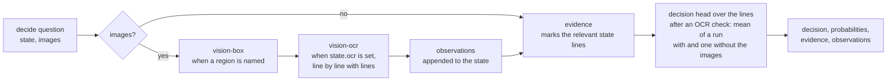

# Typed decisions

A `decide` question asks for a decision about any state: JSON, text, and optionally images. Without `options` the answer is `yes` or `no`; with `options` it is one of them. Every answer carries the probability of each outcome, the passages of the state the decision rests on, and what the image tasks saw.

```ts
import type { Span } from "defuss-decide";

type DecideQuestion = {
  type: "decide";
  instructions: string; // the decision as a question: "Is the order fulfilled?"
  options?: Record<string, string | null>; // option -> description; at least two
  region?: string; // with one image: the object vision-box looks for; without it there is no region step
  lines?: boolean; // with one image and state.ocr: check the OCR text line by line on located strips
};
type DecideAnswer = {
  type: "decide";
  decision: string; // "yes" | "no" | one of the options
  probabilities: Record<string, number>;
  evidence: Evidence[]; // the passages of `context` that bear on the decision
  context: string; // the state as text lines, observations included
  observations: string[]; // what the image tasks found
};
type Evidence = {
  start: number; // offsets in `context`, Unicode code points, `end` exclusive
  end: number;
  label: "evidence";
  score: number;
  probability?: number;
  observations_ref: number[]; // indexes into `observations` of the observation lines the passage covers
  state_ref: string[]; // paths of the state fields it covers ("order.status"); empty for a text state
};
```

## Pipeline

`VelaProvider` answers a `decide` question in up to four steps. Each step runs for all `decide` questions of the request before the next, so every bundle loads at most once per request.



1. **Image tasks (with exactly one image).** With a `region`, `vision-box` looks for it and adds `the image shows <region> (confidence c)` at a confidence of 0.5 or more, else `the image does not show <region> (confidence c)`. When the state has an `ocr` field, `vision-ocr` checks it against the scan and adds each passage the scan does not support, or `OCR text matches the scan`. With `lines: true` it checks each line on its own strip of the image ([OCR line by line](#ocr-line-by-line)).
2. **State as text.** JSON becomes one `path: value` line per field (`order.items.0.shipped: 2`); the observations follow as `observations.<n>` lines. Text state stays as it is.
3. **Evidence (when a `fast.evidence` bundle is configured).** The evidence adapter marks the lines that bear on the question. They explain the answer; they do not decide it. Each passage names what it covers instead of repeating its text: state fields by path (`state_ref`), observations by index (`observations_ref`); its offsets index `context`.
4. **Decision.** The `decision` bundle of the request's kind answers a `noul` (yes/no) or `choice` question over the same text lines, observations included. With images, the vision decision head also reads the images, up to three; with two or three, the image tasks are skipped, since they take exactly one. After an OCR check, the head answers twice, with the images and from the lines alone, and the decision is the mean of both.

Why the decision head decides and evidence only explains: VERIFIED: scoring "Yes" against "No" by their evidence spans picked right in 3 of 7 JSON cases, chance level, while the text decision head answers 19 of 20 status cases (probe, 2026-11-08; `reports/decide/node-auto.json`). The evidence adapter finds the relevant fields, not whether an answer is true.

Why the region line says "does not show": the region adapter returns a box for any description, even an absent one. VERIFIED: a plain box line for "the green triangle" (confidence 0.01) raised the vision head's p(yes) from 0.12 to 0.91; with the wording above, 4 of 4 image cases were answered right (probe, 2026-11-08).

Why the decision head reads text lines instead of the JSON state: VERIFIED: the text head answered 19 of 20 status cases with lines and 18 with JSON, and the vision head read OCR findings right in 10 of 12 cases with lines and 8 with JSON (probes, 2026-11-08). Why the region step needs `region`: the instructions are a question, not an object, and lines such as `the image shows Is the background white?` misled the head.

Why the mean of two runs after an OCR check: the vision head reads objects in an image well but small text badly, and with the image it overrode the OCR check. VERIFIED: the mean answered 12 of 12 OCR decisions; the image alone 8 of 12. After a region step the mean answered 9 of 13 image cases against 10 of 13 without it, because the region line can report absent objects; so only the OCR check triggers it (2026-11-08, [plans/decide-research.md](../plans/decide-research.md)).

## Bundles

| Request | Needed | Optional |
| --- | --- | --- |
| No images | `fast.decision` | `fast.evidence` |
| With images | `vision.decision` | `vision.box`, `vision.ocr`, `fast.evidence` |

A missing decision bundle fails before anything loads. Export the decision bundles as in [decisions.md](decisions.md#export); the task bundles as in [models.md](models.md). One bundle is resident at a time, so a request with images loads up to four bundles in turn (1.5 to 4.7 s each in Node.js, [performance.md](performance.md)).

## Examples

Options with descriptions steer the decision. A partially paid invoice:

```js
import { loadVelaProvider } from "defuss-decide/node";

const vela = await loadVelaProvider({
  fast: { decision: "models/decision/fast", evidence: "models/vela3-fast-onnx/evidence/fp32" },
  vision: {
    decision: "models/decision/vision",
    box: "models/vela3-fast-onnx/vision-box/fp32",
    ocr: "models/vela3-fast-onnx/vision-ocr/fp32",
  },
});
try {
  const next = await vela.systemOne({
    state: { invoice: { number: "R-9", total: 300, paid: 150, status: "partially paid" } },
    questions: {
      action: {
        type: "decide",
        instructions: "What should happen with this invoice?",
        options: { close: "The invoice is paid in full", remind: "Payment is missing or incomplete" },
      },
    },
  });
  const { decision, probabilities } = next.answers.action;
  console.log(decision, JSON.stringify(Object.fromEntries(Object.entries(probabilities).map(([k, p]) => [k, p.toFixed(2)]))));
  // => remind {"close":"0.02","remind":"0.98"}

  const scan = await vela.systemOne({
    state: { ocr: "Invoice 128\nTotal: EUR 92.00" },
    images: ["models/vela3-fast-onnx/vision-ocr/fp32/sample.png"],
    questions: {
      matches: { type: "decide", instructions: "Does the extracted invoice text match the scanned document?", region: "the invoice total" },
    },
  });
  console.log(scan.answers.matches.decision);
  // => no
  console.log(JSON.stringify(scan.answers.matches.observations));
  // => ["the image shows the invoice total (confidence 0.75)","OCR text not supported by the scan: \"Invoice 128\"","OCR text not supported by the scan: \"EUR 92.00\""]
} finally {
  await vela.dispose();
}
```

The scan reads `Invoice 123` and `EUR 42.00`, so the OCR check flags both fields and the decision is `no`. Asked as a plain yes/no question ("Is the invoice paid?"), the same invoice got p(yes) 0.73; the described options decide it correctly.

Decisions of the same shape that the cases below cover: has the user confirmed a payment in a chat, is an agent's task complete according to its log, may a user delete a project under a stated policy, is a flight delayed, does a patient report a fever, does a contract allow termination without notice, is a reply in German, does a code change touch the database schema, does an answer follow from its context, does a comment insult someone, is a feature flag on for a user, is an item in stock. With `options`: which team handles a message, the sentiment of a review, the severity of an incident, the kind of a document, what to do with a comment.

## OCR line by line

With `lines: true` the OCR check runs per line. `vision-box` locates every line of the OCR text in one request (`the text "<line>"`), and each line is checked on a full-width strip of its box's rows plus 25 pixels above and below. The spans index the whole OCR text, as without `lines`. The same option exists on OCR `span` questions (`{ type: "span", task: "ocr_check", criteria: ["ocr_error"], lines: true }`).

VERIFIED: with one character changed per line, the strips caught 55 of 83 changes against 42 for the whole image, with 7 false alarms on unchanged lines against 8 (`node scripts/verify-ocr-lines.ts`, `reports/ocr-lines/node-auto.json`: 5 sample images and 3 rendered documents, 2026-11-08). Why strips over the full width instead of the box: the box comes from 8 × 8 cells per 512-pixel tile and often covers only part of a line. Tight box crops cut words off, and the check then flagged them: 21 false alarms in 83 lines.

The cost is one `vision-box` request plus one OCR run per line instead of one OCR run; the runs go one after another, since the adapter takes one image per run.

## What it was measured on

`node scripts/verify-decide.ts` runs the 81 hand-written cases of `tests/fixtures/decide-cases.json` and records every answer in `reports/decide/`. VERIFIED: 74 of 81 were answered as labelled on 2026-11-08 (`reports/decide/node-auto.json`):

| Cases | Right | Misses |
| --- | --- | --- |
| 20 status decisions over JSON: orders, invoices, tickets, ages, weights, subscriptions | 19 | an invoice `partially paid` asked "Is the invoice paid?" (p(yes) 0.73) |
| 36 varied decisions, written before the pipeline changes were measured on them | 33 | a completed task in an agent log, a German reply, a minor incident between `minor` and `major` (0.50) |
| 13 image questions with a named region | 10 | a white background asked without a region; a cat and a horse that the region adapter reported although only a dog and a seahorse are there |
| 12 OCR checks against a scan, 10 of them line by line | 12 | none |

On the first 26 of these cases, the earlier pipeline (JSON state for the decision head, a region step from the instructions) answered 24, as the current one does: the current one gets the order with status `complete` right and misses the white background asked without a region.

The website's sample images add three image decisions with recorded answers: a soccer ball that is in the picture (`yes`, p 0.99), a submarine that is not (`no`, p(yes) 0.07) and a bottle whose OCR text matches its engraving (`yes`, p 0.86). VERIFIED: `node scripts/verify-samples.ts` recorded them on 2026-11-08 (`reports/samples/node-auto.json`).

With the q8 task bundles (`node scripts/verify-decide.ts auto q8`; the decision bundles exist in FP32 only), VERIFIED: 73 of 81 (`reports/decide/node-auto-q8.json`, 2026-11-08). The one case that changed is the submarine next to a dragon rider: the region adapter's confidence rose from 0.49 to 0.51, so the observation read "the image shows the submarine" and the decision turned `yes`. Every other decision was the same; the sample images answered 17 of 18 as expected for the same reason (`reports/samples/node-auto-q8.json`). A region confidence near 0.5 is where the precision can tip a decision.

These cases are a smoke test written for this pipeline, not a benchmark. UNKNOWN: accuracy on your data. Measure it on labelled examples of your own before acting on decisions automatically, and prefer options with descriptions where a yes/no question is ambiguous.

## Limits

- The state lines, the question and the label markers must fit the evidence adapter's 2,048 tokens; longer states fail instead of being cut. Without an evidence bundle, the decision head's own limit applies.
- `vision-ocr` checks OCR text you provide; it does not read text from the image.
- The region adapter reports objects that resemble a present one: "the cat" with confidence 0.97 in a picture with a dog. Its line then makes the decision `yes`. Name regions for presence checks only where a wrong `yes` is acceptable, or ask the vision decision head without `region`.
- The decision bundles are the v0.1 `choice` and `noul` heads; their parity record is in [VALIDATION.md](VALIDATION.md).
