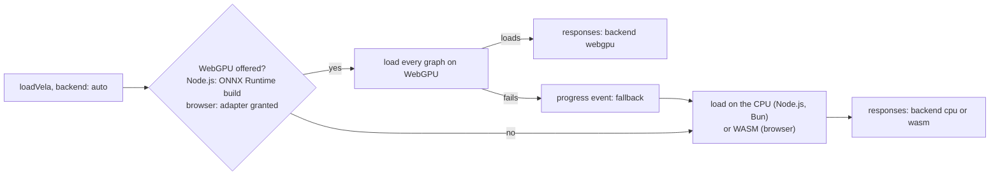

# Performance

This page shows where inference time goes, which backend runs a bundle, and which settings change the speed. Unless a line says otherwise, the numbers come from one Apple M-series Mac (18 cores, 48 GB) on 2026-11-08: `make bench` in Node.js 26.11.1 and the parity records in `reports/tasks/` for Chromium 156 and WebKit 27.2. They show proportions, not guarantees for other hardware.

## Where the time goes

| Work | Share | Measured |
| --- | --- | --- |
| Image question | the image encoder | 1,269 of 1,449 ms on 2 CPU threads (88 %); resizing the image 88 ms, now 45 ms; decoding the file 1 ms |
| Text question | the model | for 1,800 tokens: 4 ms to render the input, under 1 ms to decode the spans, the rest in ONNX Runtime |
| Loading a bundle | session creation and weights | 1.5 to 2.6 s on the CPU, 2.8 to 4.7 s on WebGPU (FP32, Node.js); a browser adds the download |

Text time grows with the input: a fixture of 20 to 60 tokens takes 22 to 42 ms on the CPU, 1,800 tokens take 1.1 to 1.6 s. The rendering and decoding in JavaScript stay under half a percent of a call, so the backend, the thread count and the precision decide the speed.

## Backends

Every bundle runs on one backend, chosen when it loads:



`backend: "cpu"` (Node.js, Bun), `"wasm"` (browser) or `"webgpu"` pins one backend, and a pinned backend that cannot load the bundle is an error. All 22 real bundles (FP32, q8, q4) passed parity on WebGPU in Node.js, Bun (`span/fp32`), Chromium and WebKit; [ADAPTER_VALIDATION.md](ADAPTER_VALIDATION.md#webgpu) has the errors.

### Node.js and Bun, FP32

`make bench` medians, CPU with the default 4 threads:

| Bundle | Input | CPU | WebGPU |
| --- | --- | ---: | ---: |
| text adapters | fixtures, 20 to 60 tokens | 22 to 42 ms | 50 to 53 ms |
| text adapters | about 1,800 tokens | 1,141 to 1,560 ms | 320 to 477 ms |
| vision adapters | one 512 px image | 1,328 to 1,367 ms | 289 to 291 ms |
| every adapter | loading | 1,467 to 2,565 ms | 2,796 to 4,670 ms |

### Browsers

Parity records of the real bundles, FP32, per fixture; the first WebGPU run of a page includes compiling its shaders:

| Bundle | Chromium, WASM, 1 thread | Chromium, WebGPU | WebKit, WebGPU |
| --- | ---: | ---: | ---: |
| text adapters | 0.30 to 0.82 s | 0.05 to 0.52 s | 0.06 to 0.47 s |
| vision adapters | 21.6 to 25.4 s | 0.35 to 0.54 s | 0.40 to 0.62 s |

## Settings

**Backend.** Keep `"auto"` unless a measurement says otherwise. For inputs of a few dozen tokens the CPU answers faster (22 to 42 ms against 50 to 53 ms) and loads faster, so a server that answers many short texts and switches bundles often may pin `backend: "cpu"`. Pin a backend also when results must not depend on the machine: the backends agree within the parity tolerance, not bit for bit.

**CPU threads.** The default is 4, or the number of cores if lower. For 1,800 text tokens on `span/fp32`:

| Threads | 1 | 2 | 4 | 8 |
| --- | ---: | ---: | ---: | ---: |
| 1,800 tokens | 1,922 ms | 1,551 ms | 1,122 ms | 1,149 ms |
| 21 tokens | 20 ms | 25 ms | 31 ms | 29 ms |

One image on `vision-span/fp32` took 1,449 ms with 2 threads and 928 ms with 8. In browsers, `threads` sets the WASM threads, which need a cross-origin-isolated page (COOP/COEP); there the default is 4, or fewer cores, as well. In Chromium, 4 WASM threads on such a page ran the `vision-span` fixture in 6.7 s instead of 22.8 s and the `span` fixtures in 0.11 to 0.19 s instead of 0.36 to 0.68 s, with parity passing (`reports/tasks/browser-*-4threads.json`). A WASM fallback therefore gains about 3× from serving the page with COOP/COEP headers.

**Precision.** The `q8` and `q4` bundles are smaller downloads (374 MB to 1.15 GB for `q8`, 1.0 to 1.7 GB for FP32) and load faster on WebGPU. On the CPU they run slower; on WebGPU about as fast as FP32. `make bench` medians in Node.js:

| Precision | 1,800 tokens, CPU | 1,800 tokens, WebGPU | Image, CPU | Image, WebGPU | Load, WebGPU |
| --- | ---: | ---: | ---: | ---: | ---: |
| FP32 | 1,141 to 1,560 ms | 320 to 477 ms | 1,328 to 1,367 ms | 289 to 291 ms | 2,796 to 4,670 ms |
| `q8` | 2,068 to 2,202 ms | 334 to 524 ms | 1,635 to 1,700 ms | 295 to 298 ms | 1,446 to 2,533 ms |
| `q4` | 4,888 to 5,051 ms | 412 to 432 ms | 4,013 to 4,201 ms | 360 to 398 ms | 1,315 to 1,687 ms |

VERIFIED: the `q4` row measures the GPTQ bundles that share one backbone file (`reports/bench/bench-q4-*.json`, 2026-11-09). That run shared the machine with other work (load average about 12), so it may read slower than the other rows, which were measured on an idle machine on 2026-11-08.

In Chromium the WebGPU text checks took 0.05 to 0.17 s with `q8` and 0.05 to 0.52 s with FP32. Browsers, which download the bundle, therefore gain most from `q8` or `q4` on WebGPU; on the CPU, FP32 is the fastest.

**Request shape.** Ask every question about one image in one request: a bundle decodes and encodes the image once per request, not once per question, and renders every question before the first inference, so an invalid question fails before the encoder runs. The provider routes all questions of a request first and then answers each adapter's questions together, starting with the adapter already loaded; across requests, consecutive requests for the same adapter avoid a reload.

## Measuring

```bash
make bench
make bench BENCH="q8 --backend cpu --threads 8"
make parity
```

`make bench` loads every bundle of one precision under `models/vela3-fast-onnx/`, runs each fixture three times after a warm-up and reports the median, plus each text bundle's first fixture repeated to about 1,800 tokens; it writes `output/bench-<precision>-<backend>.json`. `make parity` checks the outputs on both backends ([models.md](models.md#verify-bundles)).

## Not measured

UNKNOWN: WebGPU on Linux, Windows, NVIDIA, AMD or Intel GPUs, Firefox and mobile browsers; the real v0.1 decision bundles on WebGPU (only their fixture bundles ran there); and multithreaded WASM in WebKit.
