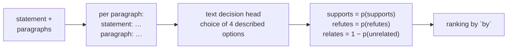

# Graph relations

A `relate` question ranks the paragraphs of the state by how they relate to a statement, for the edges of a knowledge graph:

- `supports`: the paragraph states that the statement is true;
- `refutes`: the paragraph states that the statement is false;
- `relates`: the paragraph is about the statement's topic, whether or not it takes a side.

The scores follow what a paragraph states, not what could be inferred from it. A paragraph that names a different cause refutes a statement about a cause; a qualified statement ("usually", "on Earth", "when it is not cloudy") is not refuted by a case its qualifier excludes.

```ts
import type { RelationKind } from "defuss-decide";

type RelateQuestion = {
  type: "relate";
  statement: string; // the paragraph the others are related to
  by?: RelationKind; // "supports" (default) | "refutes" | "relates": the ranking's order
};
type RelateAnswer = {
  type: "relate";
  by: RelationKind;
  // every paragraph of the state, highest `by` score first; key is the array index or the object key, and the
  // paragraph's text stays in the state
  ranking: { key: string; supports: number; refutes: number; relates: number }[];
};
```

The state holds the paragraphs: an array of strings, or an object of id to string. `relate` needs the text decision bundle (`fast.decision`); images in the request are not read by it.

## Example

The same paragraphs, ranked by `refutes` against an absolute and a qualified statement:

```js
import { loadVelaProvider } from "defuss-decide/node";

const vela = await loadVelaProvider({ fast: { decision: "models/decision/fast" } });
try {
  const r = await vela.systemOne({
    state: {
      blue: "Photo of a blue sky over the city.",
      green: "Photo of a green sky over the city.",
      grey: "On a cloudy day the sky over Berlin was grey.",
      flour: "Add two cups of flour and stir until smooth.",
    },
    questions: {
      plain: { type: "relate", statement: "The sky is blue.", by: "refutes" },
      qualified: { type: "relate", statement: "The sky is usually blue on Earth when it is not cloudy.", by: "refutes" },
    },
  });
  for (const id of ["plain", "qualified"])
    console.log(id, JSON.stringify(r.answers[id].ranking.map((p) => `${p.key} ${p.refutes.toFixed(2)}`)));
  // => plain ["grey 0.89","green 0.83","flour 0.13","blue 0.01"]
  // => qualified ["green 0.51","grey 0.11","flour 0.05","blue 0.03"]

  const cause = await vela.systemOne({
    state: [
      "The bridge was closed on Monday.",
      "Storm Ciara damaged the bridge's cables, so the city closed it on Monday.",
      "The storm damaged several roofs in the old town.",
    ],
    questions: { s: { type: "relate", statement: "The bridge was closed because of storm damage." } },
  });
  console.log(JSON.stringify(cause.answers.s.ranking.map((p) => [p.key, p.supports.toFixed(2), p.relates.toFixed(2)])));
  // => [["1","0.97","1.00"],["2","0.02","0.65"],["0","0.01","0.93"]]
} finally {
  await vela.dispose();
}
```

The grey sky refutes "The sky is blue." (0.89) but not the qualified statement, which excludes cloudy days (0.11). The closure without a cause is on topic (relates 0.93) yet does not support a statement about its cause (0.01).

To build a graph, ask one `relate` question per node with the other nodes as the state, and keep the edges whose score passes a threshold you choose on labelled pairs of your own.

## How it works



`VelaProvider` asks the text decision bundle one `choice` question per paragraph, with the state `statement: <statement>` and `paragraph: <paragraph>` on two lines and four described options: the paragraph states that the statement is true, states that it is false, is about the same topic without saying, or is about something else. One paragraph takes one inference: 22 to 42 ms on the CPU for short texts ([performance.md](performance.md)).

Why the decision head and not the evidence or unsupported-claim adapters: VERIFIED: on the first set below, the four-option question ranked the right paragraph first for every statement and relation (AUC 0.98 to 1.00). Evidence spans reached an AUC of 0.59 to 0.77, and unsupported-claim spans 0.57 to 0.92 (probe, 2026-11-08). Evidence marks relevant passages whatever their stance, so it cannot tell support from contradiction.

## What it was measured on

`node scripts/verify-relate.ts` asks the statements of `tests/fixtures/relate-cases.json` and scores each ranking against hand-written labels: the AUC (the share of differently labelled paragraph pairs ranked in label order) and whether the first paragraph carries the highest label. The record is `reports/relate/node-auto.json`.

| Set | Statements, paragraphs | supports AUC | refutes AUC | relates AUC | Top paragraph right |
| --- | --- | --- | --- | --- | --- |
| first: chose the method | 9, 45 | 0.98 | 1.00 | 1.00 | 9 of 9 per relation |
| second: written afterwards | 8, 35 | 1.00 | 1.00 | 1.00 | 8 of 8 per relation |

The second set holds the harder cases: a different stated cause, a negation, partial support ("every swan we observed was white"), a correlation without causation, and a cause buried in a three-sentence paragraph. VERIFIED: the qualified sky statement got a lower `refutes` score than the absolute one for all 3 paragraphs that its qualifier covers (a green sky photo from 0.83 to 0.51, a grey cloudy day from 0.89 to 0.11, the sky on Mars from 0.50 to 0.34; Node.js, 2026-11-08).

These sets are small and written for this check, not a benchmark. UNKNOWN: quality on long documents, other languages and domain jargon; measure on labelled pairs of your own before using a threshold.

## Limits

- Scores are calibrated per paragraph, not across statements: compare rankings, and choose thresholds on your own data.
- A single example supports a general statement only weakly: a photo of a blue sky got `supports` 0.66 for "The sky is blue.", a photo of a clear blue sky only 0.25 for "usually blue on Earth when it is not cloudy" (`reports/relate/node-auto.json`).
- Each paragraph plus the statement must fit the bundle's token limit; longer inputs fail instead of being cut.
- Paragraphs are compared one at a time with the statement, never with each other.
